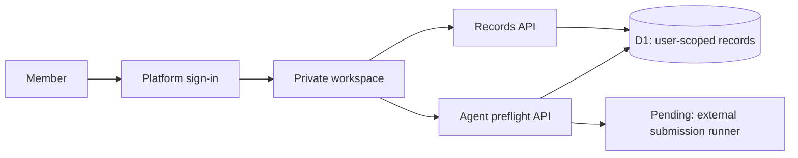

# Career Hub

**A private career workspace for job notifications, application tracking and a job-agent workflow.**

Built by [Challa Venkata Ramanji](https://github.com/ramanjichalla5) with TypeScript, React, Vinext and Cloudflare D1.

## Features

- Candidate profiles, job pipelines and recruiter conversation drafts.
- Confirmed submissions counted separately from leads and sent emails.
- Agent checks for fresher, internship and explicit 1–2-year opportunities.
- Saved run history with required answers and connection blockers.
- Platform sign-in and server-side user scopes for separate private workspaces.

## Current status

| Capability | Status |
|---|---|
| Personal dashboard and filtered notifications | Working in local owner workspace |
| Multi-user sign-in and tenant-scoped APIs | Implemented in source; hosted validation pending |
| Agent eligibility/profile checks and run history | Implemented in source |
| Automatic company-website submissions | Not connected |
| Shared hosting and member-specific integrations | Pending |

This is an actively developed portfolio project. Agent checks do not submit applications. Confirmed submissions require an actual submission date and evidence.

## Architecture



Reads and writes use the server-authenticated user ID. Browser requests cannot select another owner. Record IDs are unique within each member's workspace. New accounts start empty.

## Setup

Requirements: Node.js 22.13 or later, npm, and a Sites-compatible deployment with platform authentication and D1.

```sh
npm ci
npx tsc --noEmit
npm run dev
```

Register your own Site and configure its actual `project_id` in `.openai/hosting.json`. Configure the `DB` binding and generate/apply the Drizzle migration before serving traffic. Use the documented Sites workflow for build and deployment. The local framework preview needs a supported platform identity context; shared sign-in is owned by the hosting dispatcher.

## Source map

| File | Purpose |
|---|---|
| `app/page.tsx` | Join/sign-in gate |
| `app/member-workspace.tsx` | Private member workspace |
| `app/api/records/route.ts` | Tenant-scoped persistence |
| `app/api/agent/route.ts` | Application checks and run history |
| `lib/agent.ts` | Eligibility and required-answer checks |
| `db/schema.ts` | Drizzle database schema |

## Validation and limits

TypeScript checks passed in the development workspace. The local owner dashboard was inspected in a browser, persistence was checked, unconfirmed application updates were rejected, and private database files were inaccessible through HTTP. Full hosted authentication, tenant isolation and external submission tests remain required before opening the service to other users.

## Privacy

Personal resumes, live databases, inbox exports, application backups and runtime credentials are excluded. User records are not global seed data. Future submission services must preserve the same user boundary and retain actual employer confirmation.

## Next milestones

1. Deploy and verify two independent accounts end to end.
2. Connect each member's authorized application and email services.
3. Add a supported submission runner with deduplication and evidence.
4. Enable per-user scheduled runs and reply synchronization.
